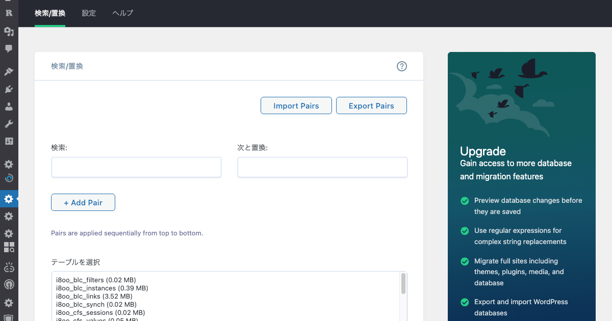
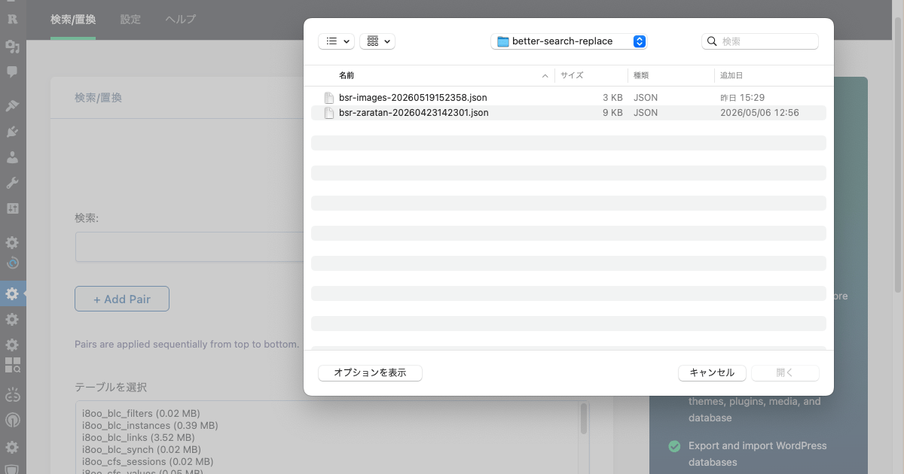
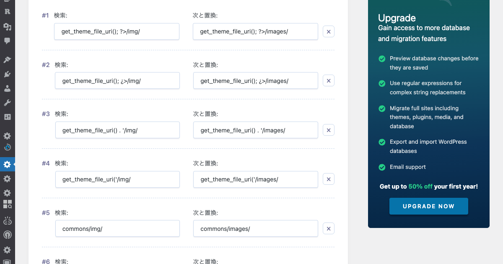

# Better Search Replace Plural v1.4.11r1

Better Search Replace v1.4.11 に「**複数ペア一括置換**」機能を追加するパッチファイル群です。

通常の Better Search Replace は検索/置換の入力欄が1組だけですが、このパッチを適用すると複数のペアをまとめて一度に実行できるようになります。ペアの保存・読み込みに対応した Import/Export 機能も追加されます。





## 動作要件

- WordPress 6.2+
- [Better Search Replace](https://wordpress.org/plugins/better-search-replace/) **v1.4.11**（他のバージョンでは動作を保証しません）
- PHP 8.1+

> BSR v1.4.11 より WordPress 6.2+ / PHP 8.1+ が必須になりました。旧環境では v1.4.10r1 をご利用ください。

## 適用方法

1. WordPress に Better Search Replace v1.4.11 を通常インストール
2. このリポジトリの `plugin/better-search-replace/` 以下のファイルを、`wp-content/plugins/better-search-replace/` に上書きコピー

```bash
cp -r plugin/better-search-replace/* /path/to/wp-content/plugins/better-search-replace/
```

> ⚠️ **注意**: 本パッチはデータベースを直接書き換えます。適用前に必ずバックアップを取得してください。

## 追加機能

### 複数ペア一括置換

- 「+ Add Pair」ボタンで検索/置換ペアを追加
- 各ペアは個別に削除可能
- Dry Run 後もペアが復元される

### 置換後のオブジェクトキャッシュ自動クリア（r1〜）

- 永続オブジェクトキャッシュ（APCu / Redis / Memcached 等の `object-cache.php`）が有効な環境では、本番実行（Dry Run 以外）の完了時に `wp_cache_flush()` を自動実行
- BSR は SQL で直接 DB を書き換えるため、クリアしないと編集画面・フロントが置換前の内容を表示し続ける
- 結果レポート（transient `bsr_results`）はキャッシュ内にあるため、クリアの前後で退避・復元する

### 更新通知の抑止（r1〜）

- プラグインヘッダーに `Update URI` を指定し、wordpress.org の公式版（例: 1.4.11）を「新バージョン」として通知しないようにした（WordPress 5.8+）
- 公式版で「更新」するとパッチが消えるため。本体の新版への追従は README の手順で行う

### Import / Export

- **Export Pairs**: 画面のペアを JSON ファイルとしてダウンロード（ファイル名: `bsr-pairs-YYYYMMDDHHMMSS.json`）
- **Import Pairs**: JSON ファイルを読み込んでペアを復元
- 全処理クライアントサイド完結（サーバー往復なし）

Export されるファイルの形式:

```json
{
  "format": "bsr-pairs",
  "version": 1,
  "exported_at": "2026-04-17T12:34:56.789Z",
  "pairs": [
    { "search_for": "https://old.example.com", "replace_with": "https://new.example.com" },
    { "search_for": "old-name", "replace_with": "new-name" }
  ]
}
```

## 変更ファイル一覧

### PHP（4ファイル）

| ファイル | 変更内容 |
|---------|---------|
| `better-search-replace.php` | Plugin Name / Version / BSR_NAME リネーム、`Update URI` 追加（`Requires at least` / `Requires PHP` ヘッダーは本体の版数チェックが読むため維持） |
| `includes/class-bsr-admin.php` | ペア UI 用スクリプト変数追加、`prefill_value()` 配列対応、`get_prefill_pairs_json()` 新設、Import/Export 用ローカライズ文字列追加、ペア数の結果表示 |
| `includes/class-bsr-ajax.php` | `search_for[]` / `replace_with[]` 配列パース、ペア構築、ペア別レポート集約、本番実行後のオブジェクトキャッシュクリア（`maybe_flush_object_cache()`） |
| `includes/class-bsr-db.php` | `apply_pairs()` ヘルパー追加、`srdb()` 2箇所を `apply_pairs()` に置換 |

### テンプレート（1ファイル）

| ファイル | 変更内容 |
|---------|---------|
| `templates/bsr-search-replace.php` | 単一入力 → ペアコンテナ UI（`#bsr-pairs-container`、動的追加/削除）、Import/Export ツールバー追加 |

### JS / CSS（4ファイル）

| ファイル | 変更内容 |
|---------|---------|
| `assets/js/better-search-replace.js` | ペア追加/削除/番号更新、DOM 安全生成、バリデーション、Import/Export 機能 |
| `assets/js/better-search-replace.min.js` | 上記の minified 版 |
| `assets/css/better-search-replace.css` | ペア管理 UI の CSS 追加（末尾約 80 行） |
| `assets/css/better-search-replace.min.css` | 上記の minified 版 |

> **注意**: `.min.js` / `.min.css` は必須です。WordPress は `SCRIPT_DEBUG` が未定義の場合、minified 版を優先的に読み込みます。

## BSR 本体アップデート時の追従手順

Better Search Replace がアップデートした場合、以下の手順でパッチを作り直してください。

**方針**: 既存パッチに本体差分をマージするのではなく、**新バージョンのファイルを新しいベースとして、パッチ内容を再適用する**。BSR はセキュリティ修正でファイル全体を書き換えることがあるため、この方向のほうが安全です。

1. BSR 新バージョンのリリースノートを確認（`README.txt` の Changelog）
2. 新旧の zip を `gitignore/` に置いて展開し、3 方向の差分を取る:
   ```bash
   unzip -q gitignore/better-search-replace.<old>.zip -d /tmp/old
   unzip -q gitignore/better-search-replace.<new>.zip -d /tmp/new

   # ① 本体の変更内容（何が変わったか）
   diff -u /tmp/old/better-search-replace/<file> /tmp/new/better-search-replace/<file>

   # ② 自分たちの変更内容（何を足したか）
   diff -u /tmp/old/better-search-replace/<file> plugin/better-search-replace/<file>
   ```
3. 新バージョンのファイルをベースにコピーし、② の変更を再適用
4. 再適用後、新バージョンとの差分が意図どおりか確認:
   ```bash
   diff -u /tmp/new/better-search-replace/<file> plugin/better-search-replace/<file>
   ```
5. JS/CSS を変更した場合は minified 版を再生成:
   ```bash
   npx terser assets/js/better-search-replace.js --compress --mangle \
     --source-map "url='better-search-replace.min.js.map'" \
     -o assets/js/better-search-replace.min.js
   npx clean-css-cli -o assets/css/better-search-replace.min.css assets/css/better-search-replace.css
   ```
6. シンタックスチェックと、min 版へのペア機能の混入確認:
   ```bash
   php -l plugin/better-search-replace/includes/*.php
   node --check plugin/better-search-replace/assets/js/better-search-replace.min.js
   grep -c 'bsr-pairs-container' plugin/better-search-replace/assets/js/better-search-replace.min.js  # 0 なら生成失敗
   ```
7. 動作確認

## 設計上の注意点

- **trim 禁止**: 検索/置換文字列に trim を適用しない（スペース消失防止）
- **空 replace_with 許容**: 空文字での置換（＝削除）は正当な操作
- **ペア ID**: カウンター増加のみ、リセット禁止（ID 重複防止）
- **DOM 生成**: innerHTML 禁止、createElement + textContent 使用（XSS 防止）
- **Text Domain**: `better-search-replace` を維持（既存翻訳互換）
- **型チェック**: `parse_str()` 由来の配列要素は文字列とは限らないため、`stripslashes()` 適用前に `is_string()` で判定（PHP 8 の TypeError 防止）
- **キャッシュクリア**: 本体追従で `class-bsr-ajax.php` を作り直す際も、完了処理（`maybe_update_site_url()` の直後）の `maybe_flush_object_cache()` 呼び出しと `Update URI` ヘッダーを再適用する
- **インライン JSON**: `wp_json_encode()` に `JSON_HEX_TAG` 等を指定し、ユーザー入力が `<script>` を脱出しないようにする

## ベースバージョン

- Better Search Replace: **v1.4.11**
- パッチバージョン: **v1.4.11r1**

### バージョン対応表

| パッチ | ベース BSR | WordPress | PHP |
|-------|-----------|-----------|-----|
| v1.4.11r1 | v1.4.11 | 6.2+ | 8.1+ |
| v1.4.10r1 | v1.4.10 | 5.0+（更新通知の抑止は 5.8+） | 7.4+ |

## License

GPL-2.0. Based on [Better Search Replace](https://wordpress.org/plugins/better-search-replace/) by WP Engine, licensed under GPL-2.0.